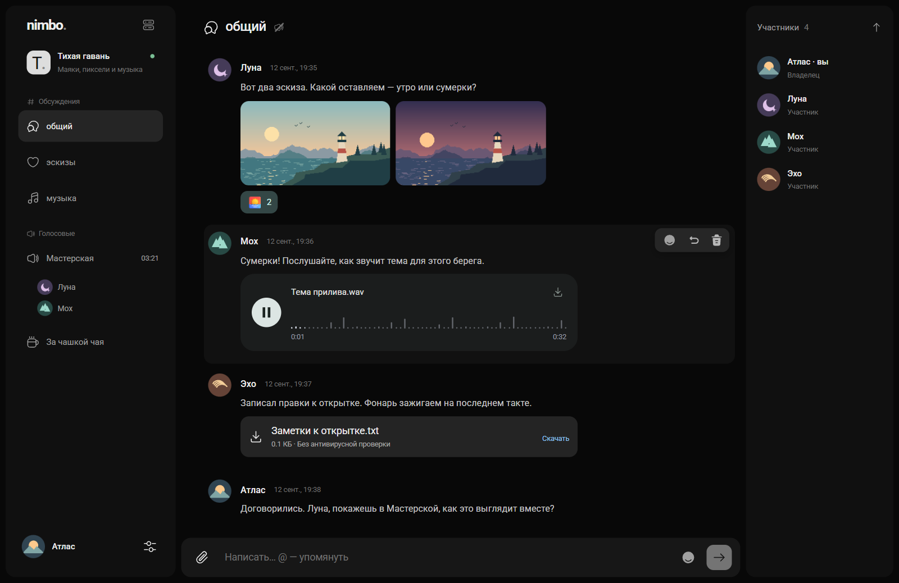
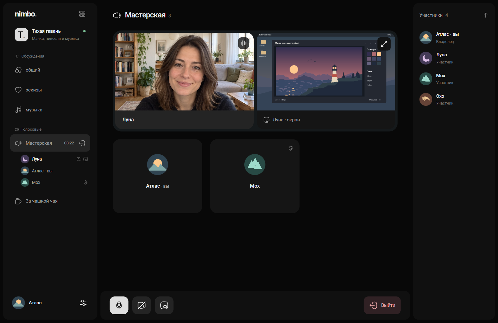
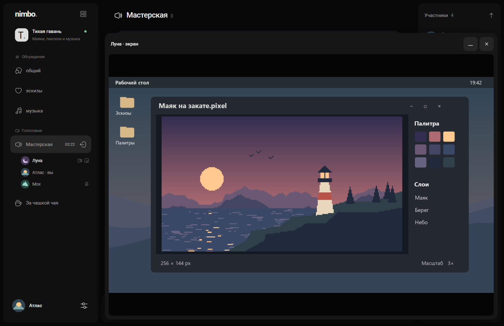
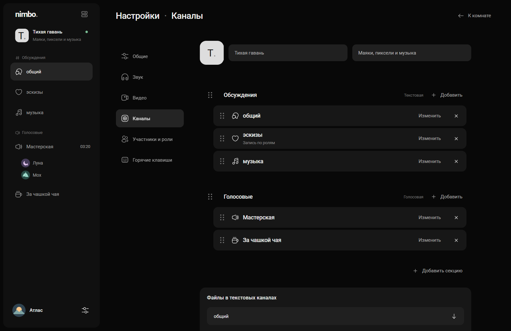
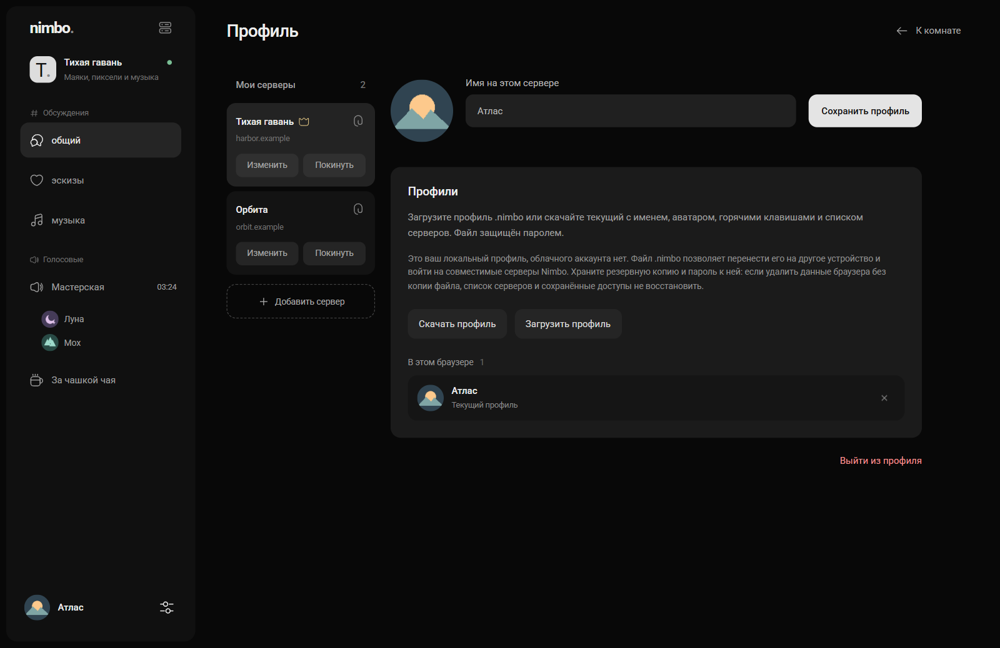

# nimbo.

[Релизы и история изменений](CHANGELOG.md)

Nimbo. — приватная звонилка для друзей. Разворачивается на своём сервере там, где вам удобно, отправляете друзьям приглашение и заходите играть. При входе по приглашению каждый выбирает себе ник. Почта, номер телефона, настоящее имя и фотография не нужны.

Каждый сервер работает самостоятельно. У Nimbo. нет общей базы пользователей и центральной учётной записи. Один локальный профиль позволяет заходить на несколько серверов, а переписка и вложения хранятся на том сервере, где вы их отправили.

## Как выглядит Nimbo.

[](docs/screenshots/chat.png)

| Голосовая комната | Демонстрация экрана |
| --- | --- |
| [](docs/screenshots/call.png) | [](docs/screenshots/screen.png) |
| В «Мастерской» камера и экран видны рядом. Остальные участвуют голосом. | Трансляцию можно развернуть, чтобы рассмотреть рисунок, или свернуть в мини-плеер и вернуться в чат. |

| Каналы | Локальный профиль |
| --- | --- |
| [](docs/screenshots/channels.png) | [](docs/screenshots/profile.png) |
| В секции «Обсуждения» собраны текстовые каналы, а в «Голосовых» — комнаты для звонков. | Профиль: его можно скачать и перенести на другое устройство. |

## Что можно делать

- Переписываться в текстовых каналах, собираться в голосовых комнатах, включать камеру и показывать экран.
- Группировать каналы по секциям, приглашать друзей и выдавать им роли. Для каждого текстового канала можно выбрать, кто в нём пишет.
- Делиться файлами, открывать фотографии и слушать аудио или смотреть видео во встроенном плеере прямо в чате.

В стартовом шаблоне есть текстовый канал «общий» и две голосовые комнаты — «Гостиная» и «Проверка звука».

## Локальный профиль

Профиль живёт локально. В нём хранятся ник, аватар, если вы его добавили, список серверов и ключи для входа на каждый из них. Тем же профилем вы входите и на серверы, которыми владеете. Права владельца подтверждает сам сервер.

В разделе «Профиль» можно скачать резервную копию в формате **`.nimbo`**. Файл шифруется на вашем устройстве паролем, который вы задаёте при скачивании. Загрузите файл на другом устройстве и введите пароль, чтобы перенести доступы к серверам, горячие клавиши и настройки эффектов камеры.

**Сохраните копию профиля и пароль к ней.** Если очистить данные браузера или потерять устройство, без доступной копии вы потеряете сохранённый список серверов, ключи входа и настройки профиля. Централизованного восстановления нет.

## Клиенты

Сейчас Nimbo. работает в браузере. Первыми в планах идут приложения для **Windows и macOS**. Позже, возможно, появятся версии для Android и iOS.


## Условия использования

> *Редакция от 9 ноября 2026 года*
>
> **Nimbo. создан в учебных целях.** Его можно использовать для обучения, преподавания, исследований и общения. Исходный код распространяется по лицензии MIT.
>
> Запрещено использовать Nimbo. в любых противоправных целях, в том числе для подготовки или совершения противоправных действий либо содействия им.
>
> Каждый пользователь отвечает за свои действия при использовании Nimbo. и за материалы, которыми он делится. Администратор самостоятельно управляет своим сервером и определяет, кому предоставить доступ. По вопросам работы конкретного сервера обращайтесь к его администратору.
>
> Программа предоставляется «как есть». Разработчики не несут ответственности за то, как пользователи и администраторы сторонних серверов используют Nimbo. Это относится и к последствиям их самостоятельных действий.

## Что где находится

| Каталог | Содержание |
| --- | --- |
| `server/` | Go API: участники, приглашения, роли, сообщения, файлы, выдача токенов LiveKit |
| `web/` | Отдельные исходники клиента Vue / TypeScript и локальные ресурсы |
| `deploy/selfhost/` | Предварительный установщик Linux, CLI `nimbo help`, шаблоны инфраструктуры |
| `deploy/antivirus/` | ClamAV, локальный менеджер и автоматическая установка вместе с сервером |
| `scripts/` | Сборка API и подготовка установочного пакета |
| `docs/` | Формат профиля, вложения, модель угроз и подготовка к эксплуатации |


## Сборка из исходников

Нужны Node.js 24, npm и Go 1.27 (или совместимые версии). После клонирования:

```sh
npm --prefix web ci --ignore-scripts
npm --prefix web test
node scripts/build-server.mjs
```

Последняя команда проверяет типы, собирает клиент, встраивает ресурсы в Go API, запускает полный серверный набор тестов и `go vet`, затем создаёт бинарник в `build-server/`. `server/ui/` — генерируемый каталог; исходники клиента находятся в `web/`.

Сборка контейнера из корня репозитория:

```sh
docker build -f deploy/Dockerfile -t nimbo:review .
```

Контейнер API сам по себе не заменяет LiveKit, TLS и настройку доменов. Для Linux-пакета после установки зависимостей:

```sh
node scripts/package-selfhost.mjs
```

Дальше следуйте [инструкции самостоятельной установки](deploy/selfhost/README.md). Установщик поднимает API проекта Nimbo. вместе с LiveKit, Caddy и по умолчанию ClamAV. При ОЗУ менее 4 GiB требуется явно выбрать установку антивируса. Для стандартных лимитов с ClamAV ориентир — 6–8 GiB ОЗУ, 2 vCPU и место под выбранный дисковый том плюс 3 GiB запаса. Порт выбирается при установке; служебные порты распределяются автоматически. Каждая установка получает лимиты CPU/RAM и отдельный ограниченный том. При нехватке ресурсов установщик отказывает до запуска. Он рассчитан на новый Linux amd64 сервер с Docker Compose и настроенными DNS-именами. Установка поверх существующего каталога запрещена.

Готовой публичной команды `curl | sh`, подписанных релизов и автоматического обновления пока нет. Не скачивайте и не запускайте вымышленные установочные URL.

## Безопасность и ограничения

- TLS защищает соединение. **Сквозное шифрование сообщений ещё не реализовано:** администратор хоста с доступом к базе может прочитать переписку.
- Пароль `.nimbo` защищает экспортируемый файл; он не делает безопасным импорт в недоверенный веб-интерфейс.
- Антивирус снижает риск, но не гарантирует обнаружение всех угроз. Ошибка проверки блокирует публикацию файла, если проверка включена.
- JSON-хранилище рассчитано на один процесс записи. Реплики API над одной базой не поддерживаются.
- В настройках звука доступны GTCRN (по умолчанию), RNNoise, шумоподавление браузера и отключение обработки шума. Автоматическое усиление микрофона отключено. Сборка с `VITE_AUDIO_LAB=0` использует шумоподавление браузера. Качество на физических микрофонах проверяется отдельно.
- Чистая установка, восстановление резервной копии, внешние звонки и TURN должны пройти приёмку перед публичным запуском. См. [подготовку к production](docs/PRODUCTION.md).

## Лицензии

Собственный код — [MIT](LICENSE). Зависимости и ресурсы сохраняют свои лицензии; см. [THIRD_PARTY.md](THIRD_PARTY.md). Приватность репозитория не заменяет проверку прав на зависимости перед публичным выпуском.

## Поддержать проект

- [Поддержать через DonationAlerts.](https://www.donationalerts.com/r/ajurion)
- Bitcoin (BTC) — `1JyhWD9XppxU39ryrtux6xn2RmNW1wcZWw`
- Ethereum (ETH) — `0xA3EdFFfc60B5606259308DA8cD468832C450b0eE`
- USDT (TRON, TRC20) — `TNi2B8DnNeZ4X4PvcZERx6S8S4KCaxD2eE`
